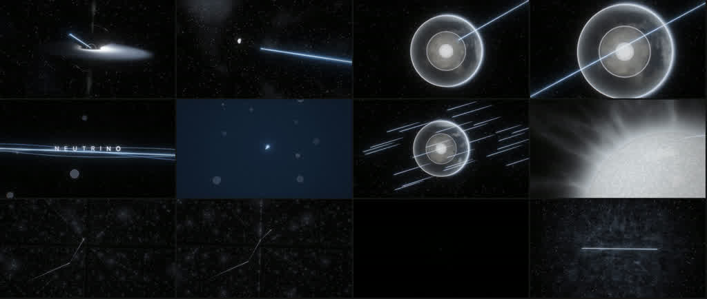
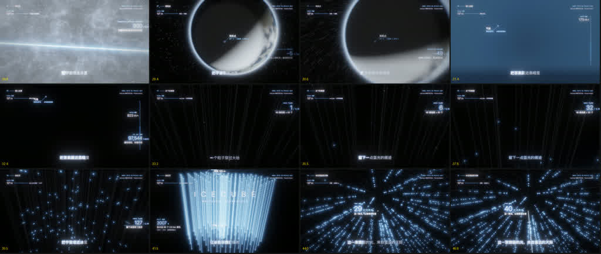
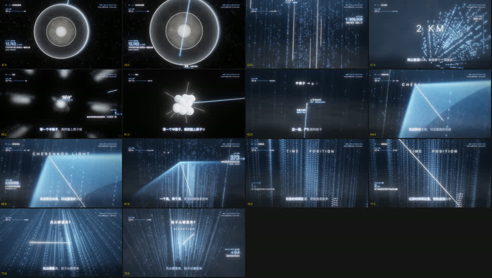
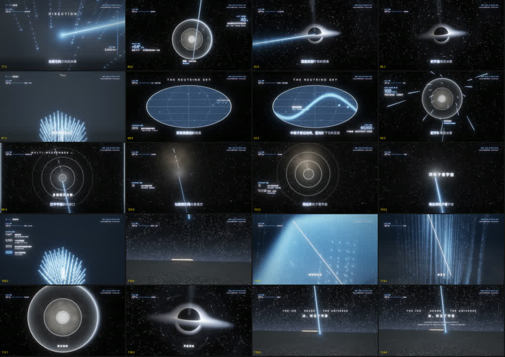

# ai-vibecoding-film-skill — 把一首歌变成逐拍对齐的科普音乐电影（Three.js + GLSL）

[English](README.md) | **简体中文**

**ai-vibecoding-film-skill 是什么？** 一条把歌曲（mp3 + 歌词 SRT 字幕）变成科学准确、逐拍对齐的音乐电影的完整流水线，全部用代码完成：场景用 Three.js + 手写 GLSL 着色器实时编写，无头 Chrome 确定性逐帧渲染，ffmpeg 合成 1080p 成片。参考影片《NEUTRINO》（2:04）讲述[南极冰立方中微子天文台](https://zh.wikipedia.org/wiki/冰立方中微子天文台)如何在冰下"抓住幽灵粒子"，即由本 skill 端到端产出。

> **快速开始：** `git clone https://github.com/haitaoworkspacebj/ai-vibecoding-film-skill.git && cp -R ai-vibecoding-film-skill ~/.claude/skills/srt-science-mv` —— 然后直接对 agent 说「根据这首歌做一部科普 MV」。完整步骤见下方「安装 skill」。

## 关键数据

| | |
|---|---|
| **参考影片** | 《NEUTRINO》— 2:04，7 幕，中文歌词科普 MV |
| **节拍锁定** | 129.3 BPM、33 句歌词（SRT）、4 处贝斯空拍 + 结尾硬停——每次剪辑都落在歌词句点、节拍或空拍上 |
| **渲染** | Three.js 0.186 + 12 个自写 GLSL 场景（吸积盘、地球内部、宇宙网均为体积光线步进） |
| **导出** | 无头 Chrome 确定性逐帧，每帧 5–6 个子帧运动模糊（180° 快门）→ ffmpeg H.264 1080p24，BT.709 |
| **质量门禁** | 结构检查 `SHOT CHECK OK`（镜头时间轴无空隙/重叠）+ 每幕结束看分镜联系表 |
| **科学准确性** | 画面数字逐一核对（2 km 深度、DOM 间距约 130 m、冰中 Cherenkov 角 41°、上行事例筛选）；中微子本身不发光——蓝光只出现在相互作用之后，来自带电的 μ 子 |
| **技术栈** | Node ≥ 22、Python ≥ 3.11、ffmpeg ≥ 6、macOS + Chrome（ANGLE Metal） |

## 🎬 视频 Demo

[](https://youtu.be/udoDeuotY6Y)

**▶ YouTube 观看：<https://youtu.be/udoDeuotY6Y>**

> GitHub 的 Markdown 没有视频播放器——`<video>` 标签会被剥掉，指向仓库内 `.mp4` 的链接也只渲染成纯链接——所以 Demo 在 YouTube 播放。同一文件也随仓库提交：[out/NEUTRINO_480p.mp4](out/NEUTRINO_480p.mp4)（854×480，4.6 MB，H.264）。

> **均为压缩版：** 仓库内的视频副本、画廊图片和参考歌曲都经过压缩，便于网络传输、在 GitHub 上快速加载。视频是 480p H.264 网络转码版（音频 48 kbps），分镜联系表是二次压缩的 JPEG，`references/example_input.mp3` 是歌曲的 128 kbps 压缩版——用它做音乐分析仍能得到完全一致的节拍数据。流水线本身输出的是 1920×1080 24 fps 全质量母版（H.264 CRF 14、BT.709、AAC 320 kbps）——按「使用方法」里的导出命令即可得到全质量版本。

## 🖼 分镜画廊（联系表 · 压缩版）

**第 I 幕——起源与幽灵**（黑洞发射 → 飞行 → X 光地球 → 轨迹本身）：


**第 II 幕——埋进冰里**（垂直冲入南极冰层，IceCube 探测器逐颗点亮）：


**第 III–IV 幕——穿越地心与捕获**（上行轨迹贯穿地球，Cherenkov 光锥，探测器级联点亮）：


**第 V–VII 幕——新的窗口**（方向重建指向源头，多信使通道，尾声）：


## 流水线原理

1. **音乐分析** — `mv/timeline.py` 从音频提取 BPM、节拍相位、贝斯空拍与下沉段 → `web/media/timeline.json`。所有镜头时间都从它 + SRT 推导，镜头代码里不出现字面秒数。
2. **分镜设计** — `docs/分镜设计.md` 把 7 幕对应到音乐段落，每个镜头锚定"第 N 句 / 节拍 / 空拍"。
3. **场景即着色器** — 每个镜头 = GLSL（`web/src/glsl/`）+ JS 时间轴（`web/src/shots/`）：体积光线步进、按像素定宽的解析轨迹线、HDR Bloom → ACES → 胶片颗粒后期链。
4. **确定性导出** — `tools/export.mjs` 驱动无头 Chrome 按精确时间戳渲染（`--workers N` 并行），PNG 帧流入 ffmpeg，再合入对应歌曲片段。重复渲染结果一致。
5. **质检** — `scripts/qa.sh` + `scripts/stills_sheet.sh` 生成分镜联系表；渲染前 `SHOT CHECK` 校验镜头时间轴。

## 仓库结构

| 路径 | 说明 |
|---|---|
| `SKILL.md` | skill 入口：非可协商规则、复现步骤、新片流程 |
| `references/` | pitfalls.md、architecture.md、示例输入——歌曲 `example_input.mp3` + 歌词 `example_input.srt`、示例 timeline |
| `scripts/` | setup_project.sh、qa.sh、stills_sheet.sh |
| `template/` | 引擎模板（web/ + tools/ + mv/），做新片时整体复制 |
| `web/ tools/ mv/ docs/` | 参考影片《NEUTRINO》的工程现场 |
| `docs/images/` | 压缩后的分镜联系表（上方画廊） |
| `out/NEUTRINO_480p.mp4` | 成片（480p 便于在 GitHub 内直接播放） |

## 📦 安装 skill

仓库本身就是 skill——安装就是把它拷进你的 agent 的 skills 目录。

**环境要求：** macOS + Google Chrome（ANGLE Metal）、Node ≥ 22、Python ≥ 3.11、ffmpeg ≥ 6。

```bash
git clone https://github.com/haitaoworkspacebj/ai-vibecoding-film-skill.git
cp -R ai-vibecoding-film-skill ~/.claude/skills/srt-science-mv   # Claude Code
# ZCode / 其他 agent：拷进对应 agent 的 skills 目录即可
```

安装到此结束。验证是否生效：直接对 agent 说「根据这首歌做一部科普 MV」/ *"make a science music video from this song"*，它应当识别 `SKILL.md` 并跑起流水线。

## 使用方法

### 1. 作为 agent skill 使用（推荐）

安装完成后（见上文），直接用自然语言下需求——「根据这首歌做一部科普 MV」即可。先读 `SKILL.md`：里面的非可协商规则是全片质量的保证（时间只来自 SRT + 音乐分析、渲染前必须 `SHOT CHECK OK`、禁止整屏过曝、画面数字必须核对）。

### 2. 复现参考影片《NEUTRINO》

```bash
bash scripts/setup_project.sh ~/work/neutrino-mv references/example_input.mp3 references/example_input.srt
cd ~/work/neutrino-mv
node tools/export.mjs --shots | tail -3      # 期望：SHOT CHECK OK
node tools/export.mjs --stills 1,5.5,12      # 快速单帧检查
node tools/export.mjs --video --workers 2 --w 1920 --h 1080 --sub 5 --out out/NEUTRINO_1080p.mp4
bash scripts/qa.sh out/NEUTRINO_1080p.mp4 124.58
```

音乐分析期望值：129.3 BPM，空拍 ≈ [29.00–29.81]、[46.32–47.14]、[85.82–86.73]、[103.21–104.05]、[124.48–126.50]。若不一致说明输入音频不同——整部影片建立在这些数字上。

### 3. 做一部新片（新歌 / 新题材）

1. `cp -R template/ ~/work/my-film && cd ~/work/my-film`
2. 放入 `song.mp3` + 歌词 `.srt`，跑 `python3 mv/timeline.py` → `web/media/timeline.json`
3. 写分镜（`docs/分镜设计.md`）：幕对应音乐段落，每个镜头锚定「第 N 句 / 节拍 / 空拍」
4. 在 `web/src/shots/` 写幕（时间轴）、`web/src/glsl/` 写场景（渲染）——主角轨迹复用 `glsl/common.glsl` 的 `trail()`
5. 浏览器预览（`node tools/serve.mjs`），每幕结束看联系表（`scripts/stills_sheet.sh`）
6. 渲染：先过 `node tools/export.mjs --shots`，再 `--video --workers 2`

**环境要求：** macOS + Google Chrome（ANGLE Metal）、Node ≥ 22、Python ≥ 3.11、ffmpeg ≥ 6。写任何镜头之前先读 `references/pitfalls.md`——每条规则都是踩坑换来的。

## 参考资料

- [南极冰立方中微子天文台](https://zh.wikipedia.org/wiki/冰立方中微子天文台) —— 影片主角，冰下立方公里级探测器
- [切连科夫辐射](https://zh.wikipedia.org/wiki/切连科夫辐射) —— 全片视觉 DNA 的蓝色光物理
- [TXS 0506+056](https://zh.wikipedia.org/wiki/TXS_0506%2B056) —— 方向重建幕指向的耀变体式中微子源
- [中微子](https://zh.wikipedia.org/wiki/中微子) —— 全片跟随的粒子
